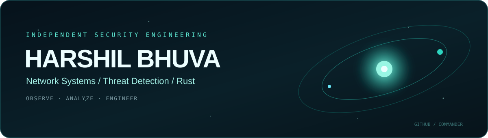
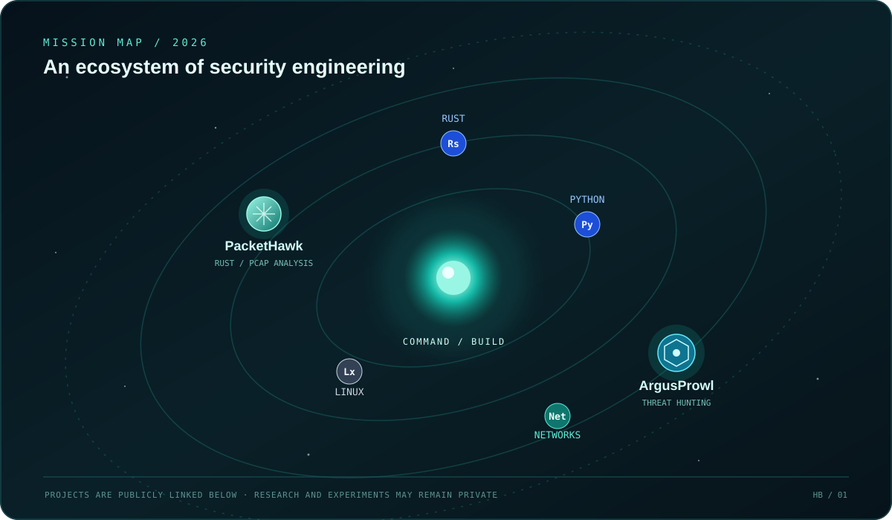
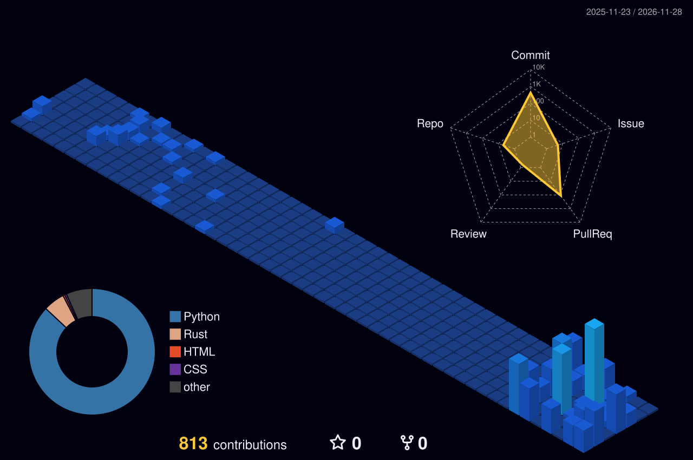

<!--
  Harshil Bhuva — GitHub profile
  Visual system: Solar / deep-space / cyan
  All illustrations in this repository are original, self-hosted SVG assets.
-->

  

  
  
  

  <strong>Security engineering · Network systems · Rust</strong> 
  I build tools for understanding network traffic, detecting threats, and making security telemetry actionable.

  

## Mission control

I'm a computer science student focused on cybersecurity and systems engineering. My work sits at the intersection of network analysis, threat detection, automation, and practical software development.

- **Build:** security tools and systems with an emphasis on clear architecture and reproducible results.
- **Investigate:** network traffic, telemetry, detection logic, and evidence.
- **Learn:** Rust, operating systems, protocols, and defensive security engineering.

  

  Projects are the planets. Engineering disciplines are the orbits. The work is always in motion.

  

## Featured missions

<table>
  <tr>
    <td width="50%" valign="top">
      <h3>🛰️ PacketHawk</h3>
      
<strong>Offline network traffic analysis in Rust.</strong>

      
Inspect PCAP/PCAPNG captures, aggregate flows, and surface security-relevant findings with an evidence-first workflow.

      

        <a href="https://github.com/HarshilBhuva/PacketHawk">Repository</a> ·
        <a href="https://github.com/HarshilBhuva/PacketHawk/releases">Releases</a>
      

      
<code>Rust</code> <code>PCAP</code> <code>Network Security</code>

    </td>
    <td width="50%" valign="top">
      <h3>🛡️ ArgusProwl</h3>
      
<strong>Security monitoring and threat-hunting platform.</strong>

      
A modular platform for collecting, normalizing, correlating, and investigating security telemetry.

      
<a href="https://github.com/HarshilBhuva/ArgusProwl">Repository</a>

      
<code>Python</code> <code>FastAPI</code> <code>React</code> <code>Detection Engineering</code>

    </td>
  </tr>
</table>

  

## Engineering stack

  

  Tools and technologies I use or actively work with — not a claim of equal proficiency across every item.

## Areas of focus

| Domain | What I work on |
|---|---|
| Network security | Packet analysis, protocols, flow metadata, traffic investigation |
| Detection engineering | Telemetry pipelines, normalization, correlation, evidence-backed alerts |
| Systems programming | Rust, performance, reliability, and resource-aware design |
| Security engineering | Linux, automation, application and infrastructure security |

  

## Activity telemetry

  

  

  

## Connect

  <a href="https://github.com/HarshilBhuva">GitHub</a> ·
  <a href="https://harshil-bhuva.vercel.app">Portfolio</a> ·
  <a href="https://tryhackme.com/p/COMMANDER">TryHackMe</a>

  Curiosity in. Evidence out. Keep building.

