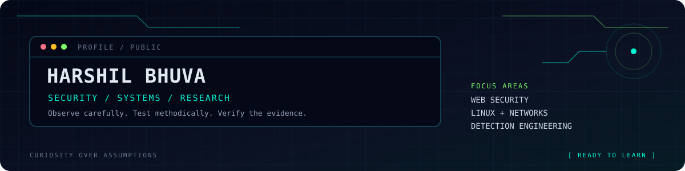

<!-- Cyber-terminal profile README. Animated artwork is self-hosted in this repository. -->

  
  
  

## `// about`

Security-minded builder focused on web application security, Linux, networking, and practical security research. I prefer methodical testing, reproducible results, and clear documentation.

## `// toolkit`

 

## `// current_focus`

- Web assessment methodology: map, test, validate, and document.
- Linux and network security fundamentals through hands-on labs.
- Python automation and detection engineering.

## `// language_snapshot`

 

